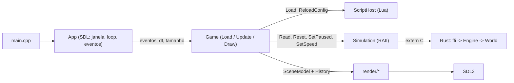
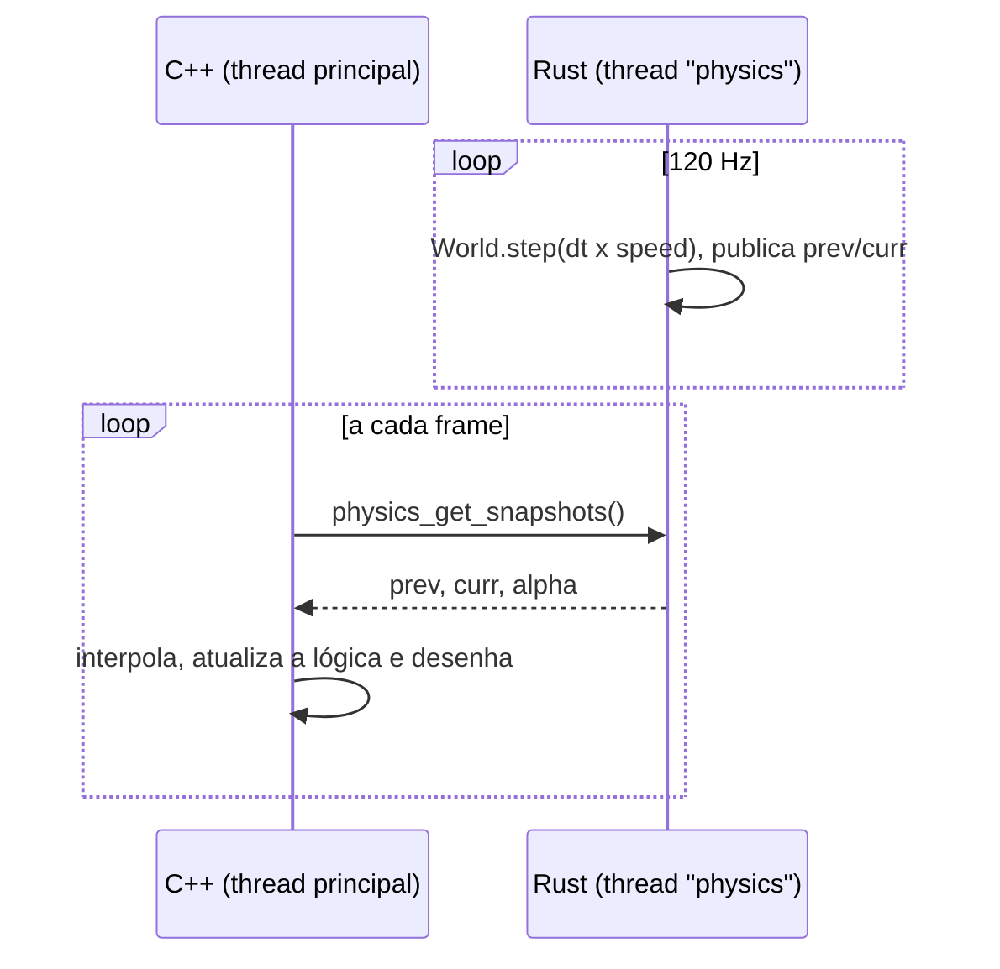

# Galilean-Inclined-Plane

> Simulation for the Galilean Experiment of Inclined Plane built with C++, Rust and Lua,
> using SDL3 for window context and rendering.

Simulação 2D do experimento do **plano inclinado de Galileu**. Uma bola desce um plano, atravessa o vale e sobe um segundo plano. A cada situação, o segundo plano fica menos inclinado (60° → 45° → 30° → 15° → 5° → 0°) até se tornar **perfeitamente horizontal**, onde a bola não para mais: é a **inércia** (movimento retilíneo uniforme).

Cada linguagem tem um papel bem definido:

| Linguagem | Responsabilidade |
|---|---|
| **C++20 + SDL3** | janela, loop principal, entrada, câmera, renderização, HUD e a "engine" (`Load / Update / Draw`) |
| **Rust** | toda a física (integração exata) e a **concorrência** (thread de física a passo fixo com snapshots) |
| **Lua 5.4** | parâmetros da cena em `scripts/config.lua`, **recarregáveis em tempo de execução** |
| **CMake** | orquestra tudo: SDL3 e Lua via `FetchContent`, o crate Rust via [Corrosion](https://github.com/corrosion-rs/corrosion) |

## Sumário

1. [O experimento de Galileu](#1-o-experimento-de-galileu)
2. [Física e fórmulas](#2-física-e-fórmulas)
3. [Métodos numéricos](#3-métodos-numéricos)
4. [Arquitetura](#4-arquitetura)
5. [Implementação](#5-implementação)
6. [Compilar e executar](#6-compilar-e-executar)
7. [Controles](#7-controles)
8. [Configuração em Lua](#8-configuração-em-lua)
9. [Testes e resultados esperados](#9-testes-e-resultados-esperados)
10. [Limitações e ideias](#10-limitações-e-ideias)
11. [Referências](#11-referências)

---

## 1. O experimento de Galileu

Na física aristotélica, todo movimento exigia uma causa contínua: sem empurrar, o corpo para. Galileu (*Discorsi*, 1638) argumentou o contrário com um experimento (em parte mental) com dois planos inclinados frente a frente:

1. Uma bola é solta do repouso a uma altura $h_0$ no plano 1, desce e atravessa o vale.
2. **Sem atrito**, ela sobe o plano 2 até **exatamente a mesma altura** $h_0$, qualquer que seja a inclinação do plano 2.
3. Quanto **menor** a inclinação $\theta_2$, **maior** a distância percorrida para atingir a mesma altura.
4. No limite $\theta_2 \to 0$ (plano horizontal), a bola nunca alcança a altura original e **continua para sempre** com velocidade constante.

A conclusão é que **um corpo livre de forças externas mantém seu estado de movimento**. Newton formalizou isso depois como a **1ª Lei** (lei da inércia).

A simulação reproduz esse raciocínio, situação por situação, mostrando o vetor velocidade, o módulo $|v|$ e a distância percorrida no plano 2.

---

## 2. Física e fórmulas

### 2.1 Aceleração em um plano inclinado

Sem atrito, as forças sobre a bola são o peso $P = mg$ e a normal $N$. Decompondo o peso em uma componente paralela e outra perpendicular ao plano:

$$P_\parallel = mg\sin\theta \qquad P_\perp = mg\cos\theta$$

$P_\perp$ é anulada pela normal, então sobra só $P_\parallel$ e a aceleração ao longo do plano é

$$\boxed{a = g\sin\theta}$$

A massa **não aparece**: todos os corpos aceleram igual, e por isso trabalhamos com grandezas **por unidade de massa**.

### 2.2 Uma única coordenada ao longo do caminho

Em vez de $(x,y)$, a bola tem uma coordenada $s$ medida **ao longo do caminho**, com $s = 0$ no vale:

```
            plano 1                    plano 2
        s < 0   ╲                   ╱   s > 0
                 ╲      vale       ╱
                  ╲      s = 0    ╱
                   ╲____________╱
         θ₁                         θ₂
```

A posição no mundo (metros, $y$ para cima) e a tangente unitária $\hat t$ (direção de $s$ crescente) são:

$$
(x,y)=\begin{cases}
(s\cos\theta_1,\; -s\sin\theta_1) & s<0\\[2pt]
(s\cos\theta_2,\; \;\;s\sin\theta_2) & s\ge 0
\end{cases}
\qquad
\hat t=\begin{cases}
(\cos\theta_1,\; -\sin\theta_1) & s<0\\[2pt]
(\cos\theta_2,\; \;\;\sin\theta_2) & s\ge 0
\end{cases}
$$

A aceleração ao longo de $s$ é $a = -g\,t_y$ (a componente do peso projetada na tangente):

$$
a(s)=\begin{cases}
+g\sin\theta_1 & s<0 \quad\text{(desce o plano 1, acelera)}\\[2pt]
-g\sin\theta_2 & s\ge 0 \quad\text{(sobe o plano 2, freia)}
\end{cases}
$$

e a altura é

$$
h(s)=\begin{cases}
-s\sin\theta_1 & s<0\\
\;\;\,s\sin\theta_2 & s\ge 0
\end{cases}
$$

A velocidade $v = \dot s$ é guardada **com sinal** ($v>0$ vai para a direita). O **vetor velocidade** desenhado na tela é

$$\vec v = v\,\hat t \qquad\Rightarrow\qquad |\vec v| = |v|$$

### 2.3 Movimento uniformemente variado

Dentro de cada plano $a$ é constante, então valem as equações do MUV:

$$v(t) = v_0 + a\,t \qquad\qquad s(t) = s_0 + v_0\,t + \tfrac12\,a\,t^2$$

### 2.4 Condições iniciais

A bola parte do repouso na altura $h_0$ do plano 1. O comprimento do plano até essa altura é

$$L_1 = \frac{h_0}{\sin\theta_1} \qquad\Rightarrow\qquad s_0 = -L_1,\quad v_0 = 0$$

### 2.5 Conservação da energia

Sem atrito, a energia mecânica **por unidade de massa** é constante:

$$\boxed{\frac{E}{m} = \tfrac12 v^2 + g\,h = g\,h_0}$$

($\tfrac12 v^2$ é a cinética $K$ e $g\,h$ a potencial $U$.) É essa igualdade que o gráfico de energia da simulação desenha, e dela saem os resultados clássicos.

**Velocidade no vale** ($h = 0$, toda a energia é cinética):

$$v_{\text{vale}} = \sqrt{2\,g\,h_0}$$

Não depende de $\theta_1$ nem de $\theta_2$. Com $g = 9{,}81\ \text{m/s}^2$ e $h_0 = 5\ \text{m}$, dá **9,90 m/s**.

**Altura máxima no plano 2** ($v = 0$): $g\,h = g\,h_0 \Rightarrow h = h_0$. A bola sempre volta à altura inicial.

**Distância percorrida no plano 2** até esse ponto:

$$\boxed{d_2 = \frac{h_0}{\sin\theta_2}}$$

**Tempos** (descida e subida):

$$t_1 = \sqrt{\frac{2L_1}{g\sin\theta_1}} = \frac{1}{\sin\theta_1}\sqrt{\frac{2h_0}{g}} \qquad\qquad t_2 = \frac{v_{\text{vale}}}{g\sin\theta_2} = \frac{1}{\sin\theta_2}\sqrt{\frac{2h_0}{g}}$$

### 2.6 O limite horizontal

Quando $\theta_2 \to 0$: $a_2 = -g\sin\theta_2 \to 0$, $d_2 = h_0/\sin\theta_2 \to \infty$ e $t_2 \to \infty$. A velocidade passa a ser constante:

$$v(t) = v_{\text{vale}} = \text{constante} \qquad\Rightarrow\qquad s(t) = v_{\text{vale}}\,t$$

que é o **MRU**, o movimento por inércia.

### 2.7 Valores esperados

Para $g = 9{,}81\ \text{m/s}^2$, $h_0 = 5\ \text{m}$ e $\theta_1 = 45°$ ($t_1 \approx 1{,}43$ s):

| $\theta_2$ | $d_2 = h_0/\sin\theta_2$ | $t_2$ | altura final |
|---:|---:|---:|---:|
| 60° | 5,77 m | 1,17 s | 5,000 m |
| 45° | 7,07 m | 1,43 s | 5,000 m |
| 30° | 10,00 m | 2,02 s | 5,000 m |
| 15° | 19,32 m | 3,90 s | 5,000 m |
| 5° | 57,37 m | 11,58 s | 5,000 m |
| 0° | ∞ | ∞ | nunca para (9,90 m/s constante) |

### 2.8 Observação: bola que rola

O modelo trata a bola como uma **partícula que desliza** sem atrito. Uma esfera maciça que **rola sem deslizar** tem $a = \tfrac57 g\sin\theta$ (parte da energia vira rotação). Mas a energia **total** (translação + rotação) também se conserva, então a altura final continua sendo $h_0$ e as distâncias $d_2$ da tabela **não mudam**. Só os tempos aumentam por um fator $\sqrt{7/5}$. O argumento de Galileu é o mesmo nos dois modelos.

---

## 3. Métodos numéricos

### 3.1 Integração exata por trechos (em vez de Euler)

Como $a$ é constante em cada plano, a solução do MUV é **exata**, e não há erro de integração dentro de um trecho. O único ponto delicado é o **vale**, onde $a$ muda de repente. Se um passo $\Delta t$ atravessa $s = 0$, calculamos o instante exato da travessia, resolvendo

$$s + v\,t + \tfrac12 a\,t^2 = 0 \quad\Rightarrow\quad t = \frac{-v \pm \sqrt{v^2 - 2as}}{a}$$

Pegamos a **menor raiz positiva** $t_c$. Se $t_c < \Delta t$, avançamos até $s = 0$, trocamos a aceleração e continuamos com o tempo restante $\Delta t - t_c$.

O resultado é uma energia conservada até o arredondamento de ponto flutuante (~$10^{-13}$). Um Euler explícito, em comparação, **ganharia energia** a cada passo e a bola subiria acima de $h_0$.

### 3.2 Parada exata no ponto mais alto

No plano 2, com $v>0$ e $a<0$, a bola para em $t^* = -v/a$. Se $t^* \le \Delta t$, o passo é encurtado até $t^*$:

$$s_{\text{apex}} = s + v\,t^* + \tfrac12 a\,t^{*2}, \qquad v = 0$$

Assim a altura final é exatamente $h_0$ (e não $h_0$ mais um erro do tamanho de um passo), e a simulação é **congelada** nesse ponto.

### 3.3 Passo fixo e velocidade da simulação

A física avança sempre em passos de $\Delta t = 1/120$ s, **independente do FPS**. A velocidade da simulação (`↑`/`↓`) só escala o tempo simulado de cada passo:

$$\Delta t_{\text{sim}} = \Delta t \cdot \text{speed}$$

Como a integração é exata para qualquer $\Delta t$, isso funciona de ×0,125 até ×8 sem perder precisão.

### 3.4 Interpolação entre snapshots

A thread de física publica os dois últimos estados, $S_{\text{prev}}$ e $S_{\text{curr}}$. A cada frame o C++ calcula

$$\alpha = \operatorname{clamp}\!\left(\frac{t_{\text{agora}} - t_{\text{curr}}}{\Delta t},\,0,\,1\right) \qquad S_{\text{desenho}} = S_{\text{prev}} + (S_{\text{curr}} - S_{\text{prev}})\,\alpha$$

O desenho fica até um passo atrasado, mas o movimento é contínuo em qualquer taxa de FPS. Ideia da *Fix Your Timestep* (Gaffer on Games).

### 3.5 Câmera

Metros (com $y$ para cima) para pixels (com $y$ para baixo), com $k$ pixels por metro e centro $(c_x, c_y)$:

$$x_{px} = \tfrac{W}{2} + (x - c_x)\,k \qquad y_{px} = \tfrac{H}{2} - (y - c_y)\,k$$

Nas situações inclinadas a escala é a que enquadra a cena inteira, $k = \min\!\left(k_{\text{config}},\; 0{,}92\,W/(x_r - x_l)\right)$. No plano horizontal, a câmera usa $k_{\text{config}}$ e segue a bola. Os dois movimentos são suavizados com $\text{valor} \mathrel{+}= (\text{alvo} - \text{valor})\,(1 - e^{-4\,\Delta t})$.

### 3.6 Contorno do vale (cosmético)

A bola é desenhada deslocada do plano por um raio $r$ ao longo da normal. Na quina as duas normais são diferentes, e a bola daria um pulo. Por isso, para $|s| < w = 2r$, a normal é misturada:

$$\mu = \tfrac12\left(\operatorname{clamp}(s/w,\,-1,\,1) + 1\right) \qquad \hat n \propto (1-\mu)\,\hat n_1 + \mu\,\hat n_2$$

com $\hat n_1 = (\sin\theta_1, \cos\theta_1)$ e $\hat n_2 = (-\sin\theta_2, \cos\theta_2)$.

---

## 4. Arquitetura

### 4.1 Camadas



Regras que mantêm o código limpo:

- **Só `script_host.cpp` conhece a API C do Lua**, e só `simulation.cpp` + `rust_api.h` conhecem a API C do Rust. O resto do programa vê `Config` e `SimSnapshot`.
- **`render/` não toma decisões.** Recebe câmera, config e `SceneModel` prontos e desenha. A lógica fica em `Game::Update`.
- **`App` não conhece física nem Lua.** O `Game` apenas *sinaliza* mudanças de janela (`TakeWindowChange`), e o `App` aplica no SDL.
- **No Rust**, `world.rs` não sabe de threads, `engine.rs` não sabe de C, e `ffi.rs` só traduz ponteiros em chamadas ao `Engine`.
- **O `lua_State` não é thread-safe**, então a thread de física nunca o toca: só a thread principal lê o script e entrega números prontos ao Rust.

### 4.2 Concorrência



O estado fica dentro de um `Mutex` no Rust. A thread de física o trava uma vez por passo e o C++ uma vez por frame, só para **copiar** os snapshots. As seções críticas são minúsculas, e o C++ nunca toca na memória do Rust diretamente.

A thread agenda os passos por **instantes absolutos** (`next += period`), então o erro do `sleep` não se acumula. Se atrasar mais de 5 passos, ela reancora o relógio em vez de disparar uma rajada de passos.

### 4.3 Estrutura de pastas

```
Galilean-Inclined-Plane/
├─ CMakeLists.txt
├─ scripts/
│  └─ config.lua              parâmetros da cena (recarregável em tempo real)
├─ physics/                   ── RUST ──
│  ├─ Cargo.toml
│  └─ src/
│     ├─ lib.rs               raiz do crate: módulos e re-exports
│     ├─ state.rs             PhysicsState (#[repr(C)], compartilhada com o C++)
│     ├─ world.rs             física pura, sem threads (+ testes)
│     ├─ engine.rs            thread de física, snapshots, pausa, velocidade (+ testes)
│     └─ ffi.rs               API extern "C": a única parte que o C++ enxerga
└─ cpp/                       ── C++ ──
   ├─ main.cpp                só cria o App
   ├─ app/                    App: SDL, loop, tempo e eventos
   ├─ game/                   Game (Load/Update/Draw) e Sequence (máquina de estados)
   ├─ lua/                    Config (dados puros) e ScriptHost (ponte com o Lua)
   ├─ physics/                rust_api.h (ABI) e Simulation (wrapper RAII + interpolação)
   ├─ render/                 Camera, primitivas, cena, HUD e gráfico de energia
   └─ core/                   Vec2, deg2rad, History (rastro e amostras de energia)
```

### 4.4 Máquina de estados das situações

```
  ┌──────────────┐  thread Rust: a bola parou      ┌─────────────┐
  │   Running    │ ─────────────────────────────▶  │   Holding   │
  │ a física corre│  no ponto mais alto (apex = 1) │ (2 s parada)│
  └──────────────┘                                 └──────┬──────┘
         ▲                                                │ acabou a pausa
         └──────── próxima situação (reset) ◀─────────────┘
```

O plano horizontal nunca chega ao ponto mais alto, então fica em `Running` para sempre, que é exatamente o MRU.

---

## 5. Implementação

Trechos principais. Os arquivos completos estão no repositório.

### 5.1 Física pura — `physics/src/world.rs`

Primeiro, a menor raiz positiva de $s + vt + \tfrac12 a t^2 = 0$:

```rust
/// Menor raiz t > EPS de  s + v*t + a*t²/2 = 0
fn first_root(s: f64, v: f64, a: f64) -> Option<f64> {
    if a.abs() < 1e-12 {
        if v.abs() < 1e-12 {
            return None;
        }
        let t = -s / v;
        return (t > EPS).then_some(t);
    }
    let disc = v * v - 2.0 * a * s;
    if disc < 0.0 {
        return None;
    }
    let sq = disc.sqrt();
    let r1 = (-v - sq) / a;
    let r2 = (-v + sq) / a;
    [r1, r2]
        .into_iter()
        .filter(|&t| t > EPS)
        .fold(None, |acc: Option<f64>, t| Some(acc.map_or(t, |m| m.min(t))))
}
```

A aceleração em cada plano e o passo de integração, com parada exata no ponto mais alto e divisão do passo na travessia do vale:

```rust
fn accel(&self) -> f64 {
    if self.on_left() {
        self.g * self.sin1      // desce o plano 1
    } else {
        -self.g * self.sin2     // sobe o plano 2
    }
}

pub(crate) fn step(&mut self, dt: f64, stop_at_apex: bool) -> bool {
    let mut remaining = dt;
    for _ in 0..8 {
        let a = self.accel();

        // vai parar de subir dentro deste passo? posiciona a bola no ponto exato
        if stop_at_apex && !self.on_left() && self.v > 0.0 && a < 0.0 {
            let t_apex = -self.v / a;
            if t_apex <= remaining {
                self.s += self.v * t_apex + 0.5 * a * t_apex * t_apex;
                self.v = 0.0;
                self.t += t_apex;
                return true;
            }
        }

        match first_root(self.s, self.v, a) {
            // atravessa o vale dentro deste passo: divide o passo
            Some(t) if t < remaining => {
                self.v += a * t;
                self.s = 0.0;
                self.t += t;
                remaining -= t;
            }
            _ => {
                self.s += self.v * remaining + 0.5 * a * remaining * remaining;
                self.v += a * remaining;
                self.t += remaining;
                return false;
            }
        }
    }
    false
}
```

O estado publicado inclui a posição, a tangente, a energia e a altura:

```rust
pub(crate) fn state(&self) -> PhysicsState {
    let (tx, ty) = if self.on_left() {
        (self.cos1, -self.sin1)
    } else {
        (self.cos2, self.sin2)
    };
    let (x, y) = if self.s < 0.0 {
        (self.s * self.cos1, -self.s * self.sin1)
    } else {
        (self.s * self.cos2, self.s * self.sin2)
    };
    PhysicsState {
        s: self.s,
        v: self.v,
        x, y, tx, ty,
        speed: self.v.abs(),
        height: y,
        energy: 0.5 * self.v * self.v + self.g * y,   // E/m = v²/2 + g h
        time: self.t,
        ..Default::default()
    }
}
```

### 5.2 Thread de física — `physics/src/engine.rs`

```rust
fn physics_thread(shared: Arc<Shared>) {
    let dt = shared.dt;
    let period = Duration::from_secs_f64(dt);
    let mut next = Instant::now() + period;

    while !shared.quit.load(Ordering::Acquire) {
        {
            let mut g = shared.lock();
            if !g.frozen && !g.paused {
                // integração analítica: exata para qualquer passo
                let sim_dt = dt * g.speed;
                let apex = g.world.step(sim_dt, true);
                g.steps += 1;
                let mut st = g.world.state();
                st.steps = g.steps;
                if apex {
                    st.apex = 1;
                    g.frozen = true;
                }
                let old = g.curr;
                g.prev = old;
                g.curr = st;
                g.curr_at = Instant::now();
            }
        }

        // agenda por instantes absolutos: o erro do sleep não se acumula
        let now = Instant::now();
        if next > now {
            thread::sleep(next - now);
        }
        next += period;
        let now2 = Instant::now();
        if now2 > next + period * 5 {
            next = now2 + period; // muito atrasada: reancora, sem rajada de passos
        }
    }
}
```

O `alpha` devolvido ao C++ é congelado durante a pausa para a imagem não dar salto:

```rust
pub fn snapshots(&self) -> (PhysicsState, PhysicsState, f64) {
    let g = self.shared.lock();
    let alpha = if g.frozen {
        1.0
    } else if g.paused {
        g.alpha_hold
    } else {
        (g.curr_at.elapsed().as_secs_f64() / self.shared.dt).clamp(0.0, 1.0)
    };
    (g.prev, g.curr, alpha)
}
```

O `Drop` do `Engine` sinaliza `quit` e faz `join` da thread, então o encerramento é sempre limpo.

### 5.3 Fronteira C ↔ Rust — `physics/src/ffi.rs` e `cpp/physics/rust_api.h`

O C++ recebe um ponteiro **opaco** e uma struct com layout idêntico dos dois lados (`#[repr(C)]` no Rust):

```rust
#[no_mangle]
pub extern "C" fn physics_create(g: f64, h0: f64, theta1: f64, theta2: f64, dt: f64) -> *mut Engine {
    match Engine::spawn(g, h0, theta1, theta2, dt) {
        Some(e) => Box::into_raw(Box::new(e)),
        None => std::ptr::null_mut(),
    }
}

/// Para a thread de física, espera ela terminar e libera o handle.
#[no_mangle]
pub unsafe extern "C" fn physics_destroy(e: *mut Engine) {
    if !e.is_null() {
        drop(Box::from_raw(e)); // Drop do Engine faz o join
    }
}
```

```cpp
extern "C" {

struct PhysicsState {
  double s, v;
  double x, y;
  double tx, ty;   // tangente unitária (direção de s crescente)
  double speed;
  double height;
  double energy;   // v²/2 + g*h (por unidade de massa)
  double time;
  uint64_t steps;  // passos de física desde o reset
  uint32_t apex;   // 1 = parou no ponto mais alto (simulação congelada)
  uint32_t _pad;
};

struct PhysicsEngine; // opaco: dono da thread de física

PhysicsEngine *physics_create(double g, double h0, double theta1, double theta2, double dt);
void physics_destroy(PhysicsEngine *e);
void physics_reset(PhysicsEngine *e, double g, double h0, double theta1, double theta2);
void physics_get_snapshots(const PhysicsEngine *e, PhysicsState *prev, PhysicsState *curr, double *alpha);
void physics_set_paused(PhysicsEngine *e, bool paused);
void physics_set_speed(PhysicsEngine *e, double speed);

} // extern "C"
```

### 5.4 Wrapper RAII e interpolação — `cpp/physics/simulation.cpp`

```cpp
// mistura dois snapshots: t = 0 -> a, t = 1 -> b
PhysicsState Interpolate(const PhysicsState &a, const PhysicsState &b, double t) {
  auto lerp = [t](double p, double q) { return p + (q - p) * t; };
  PhysicsState o = b;
  o.s = lerp(a.s, b.s);
  o.v = lerp(a.v, b.v);
  o.x = lerp(a.x, b.x);
  o.y = lerp(a.y, b.y);
  o.speed = lerp(a.speed, b.speed);
  o.height = lerp(a.height, b.height);
  o.energy = lerp(a.energy, b.energy);
  o.time = lerp(a.time, b.time);
  // a tangente muda de repente no vale: usa a do snapshot mais próximo
  if (t < 0.5) {
    o.tx = a.tx;
    o.ty = a.ty;
  }
  return o;
}

SimSnapshot Simulation::Read() const {
  SimSnapshot out{};
  if (!engine_)
    return out;
  PhysicsState prev{}, curr{};
  double alpha = 1.0;
  physics_get_snapshots(engine_, &prev, &curr, &alpha);
  out.state = Interpolate(prev, curr, alpha);  // para DESENHAR
  out.latest = curr;                           // para a LÓGICA (apex, contadores)
  return out;
}
```

### 5.5 Lua — `scripts/config.lua` e `cpp/lua/script_host.cpp`

```lua
return {
	title = "Plano Inclinado de Galileu",
	width = 1280,
	height = 720,

	physics = {
		g = 9.81,      -- m/s^2
		h0 = 5.0,      -- altura inicial da bola (m)
		theta1 = 45.0, -- ângulo do plano 1, em graus
		theta2 = 30.0, -- ângulo do plano 2 (usado se "angles" estiver vazia)
	},

	ball = {
		radius = 0.3,             -- m
		color = { 255, 153, 51 }, -- RGB
	},

	view = {
		scale = 40.0,    -- pixels por metro
		vel_scale = 0.5, -- metros de seta por (m/s)
		max_run = 70.0,  -- comprimento máximo do plano 2 (m)
	},

	-- sequência de situações: ângulo do plano 2, em graus
	angles = { 60, 45, 30, 15, 5, 0 },
}
```

O C++ executa o script e lê a tabela retornada com a API de pilha do Lua. A leitura sempre parte de uma `Config` **limpa** (com os padrões), e só sobrescreve a config atual se tudo for válido:

```cpp
// Chama fn(L) com a subtabela `name` no topo da pilha (se existir).
template <typename F> void Section(lua_State *L, const char *name, F fn) {
  lua_getfield(L, -1, name);
  if (lua_istable(L, -1))
    fn(L);
  lua_pop(L, 1);
}

bool ScriptHost::LoadConfig(const std::string &path, Config &out, std::string *err) {
  lua_State *L = L_;
  int top = lua_gettop(L);

  if (luaL_dofile(L, path.c_str()) != LUA_OK) {
    // ... devolve a mensagem de erro do Lua em *err
    lua_settop(L, top);
    return false;
  }
  // ...

  Config c; // padrões: campos removidos do script voltam ao valor padrão
  c.title = Str(L, "title", c.title);

  Section(L, "physics", [&](lua_State *L) {
    c.g = Num(L, "g", c.g);
    c.h0 = Num(L, "h0", c.h0);
    c.theta1 = Num(L, "theta1", c.theta1);
    c.theta2 = Num(L, "theta2", c.theta2);
  });
  // ... ball, view, angles

  out = std::move(c);  // só aqui a config atual é substituída
  return true;
}
```

### 5.6 O ciclo do jogo — `cpp/game/game.cpp`

```cpp
void Game::Update(double dt) {
  dt = std::min(dt, 0.25);
  status_.timer -= dt;
  PollHotReload(dt);

  SimSnapshot snap = sim_.Read();
  if (seq_.GetPhase() == Phase::Running) {
    if (snap.latest.apex) // a thread parou a bola no ponto mais alto
      seq_.OnApex(snap.latest.s, snap.latest.height);
  } else if (!paused_ && seq_.TickHold(dt)) {
    BeginSituation(seq_.Index() + 1);
    snap = sim_.Read(); // estado novo, já da próxima situação
  }

  BuildModel(snap);
  UpdateCamera(dt);

  history_.AddTrail(model_.ball);
  history_.AddEnergy(model_.st.time, model_.st.v, model_.st.height, cfg_.g);
}

void Game::Draw(SDL_Renderer *r) {
  SDL_SetRenderDrawBlendMode(r, SDL_BLENDMODE_BLEND); // rastro e painel translúcidos
  draw::SetColor(r, draw::palette::kBackground);
  SDL_RenderClear(r);
  render::DrawScene(r, cam_, cfg_, model_, history_, opts_);
  render::DrawHud(r, cam_, cfg_, model_, seq_, status_, fps_);
  if (opts_.plot)
    render::DrawEnergyPlot(r, cam_, cfg_, history_);
}
```

A geometria do frame e a posição da bola (com o contorno suave do vale, seção 3.6) são montadas em `BuildModel`:

```cpp
m.valley = {0.0, 0.0};
m.leftTop = {-H / std::tan(theta1), H};
double run2 = horizontal
                  ? cfg_.maxRun
                  : std::min(H / std::sin(theta2), cfg_.maxRun / std::cos(theta2));
m.rightEnd = {run2 * std::cos(theta2), run2 * std::sin(theta2)};

Vec2 n1{std::sin(theta1), std::cos(theta1)};
Vec2 n2{-std::sin(theta2), std::cos(theta2)};
const double w = 2.0 * cfg_.radius;
const double mix = 0.5 * (std::clamp(m.st.s / w, -1.0, 1.0) + 1.0);
Vec2 n{n1.x + (n2.x - n1.x) * mix, n1.y + (n2.y - n1.y) * mix};
const double len = std::hypot(n.x, n.y);
n = {n.x / len, n.y / len};
m.ball = {m.st.x + cfg_.radius * n.x, m.st.y + cfg_.radius * n.y};
```

### 5.7 Renderização — `cpp/render/`

O vetor velocidade é $\vec v = v\,\hat t$, desenhado a partir do centro da bola com comprimento proporcional a $|v|$:

```cpp
Vec2 vvec{m.st.v * m.st.tx, m.st.v * m.st.ty};
Vec2 tip{m.ball.x + vvec.x * cfg.velScale, m.ball.y + vvec.y * cfg.velScale};
SetColor(r, palette::kVelocity);
Arrow(r, cam, m.ball, tip);
snprintf(buf, sizeof buf, "v = %.2f m/s", std::fabs(m.st.v));
Text(r, cam, tip, 8, -14, buf);
```

A ponta da seta são duas "barbas" de 25° giradas a partir da direção do vetor:

```cpp
void ArrowPx(SDL_Renderer *r, SDL_FPoint a, SDL_FPoint b) {
  SDL_RenderLine(r, a.x, a.y, b.x, b.y);
  float dx = b.x - a.x, dy = b.y - a.y;
  float len = std::sqrt(dx * dx + dy * dy);
  if (len < 6.0f)
    return; // curta demais para ter ponta
  float ux = dx / len, uy = dy / len;
  const float head = 10.0f, c = 0.9063f, s = 0.4226f; // cos/sen de 25°
  SDL_RenderLine(r, b.x, b.y, b.x - head * (ux * c - uy * s),
                 b.y - head * (ux * s + uy * c));
  SDL_RenderLine(r, b.x, b.y, b.x - head * (ux * c + uy * s),
                 b.y - head * (uy * c - ux * s));
}
```

O gráfico de energia (`energy_plot.cpp`) usa o eixo $y$ de $0$ até $1{,}05\,g\,h_0$, e por isso $K + U$ aparece como a linha horizontal do total. O eixo $x$ é uma janela deslizante de 15 s.

---

## 6. Compilar e executar

### Requisitos

- **CMake ≥ 3.24** e um compilador **C++20** (GCC, Clang ou MSVC)
- **Git**
- **Rust** (`rustup` / `cargo`)
- No Linux, os cabeçalhos de desenvolvimento de vídeo do SDL3 (X11/Wayland, etc.). Veja a [documentação do SDL3](https://wiki.libsdl.org/SDL3/FrontPage) para a sua distribuição.

SDL3 (usa o instalado no sistema se for ≥ 3.2; senão baixa a `release-3.2.0`), Lua 5.4.7 e Corrosion v0.5 são baixados automaticamente pelo CMake (`FetchContent`).

### Build

```bash
git clone <url-do-repositorio>
cd Galilean-Inclined-Plane

cmake -S . -B build -DCMAKE_BUILD_TYPE=Release
cmake --build build -j
./build/galileu
```

O caminho de `scripts/` é gravado no executável na hora da configuração (`GALILEU_SCRIPTS_DIR`). Se mover o projeto de pasta, reconfigure com o CMake.

**Solução de problemas:** se o linker reclamar de símbolos de `pthread`, acrescente ao `CMakeLists.txt`:

```cmake
find_package(Threads REQUIRED)
target_link_libraries(galileu PRIVATE Threads::Threads)
```

---

## 7. Controles

| Tecla | Ação |
|---|---|
| `→` / `←` | próxima / anterior situação (a lista é circular) |
| `R` | reinicia a situação atual |
| `Espaço` | pausa / retoma |
| `↑` / `↓` | velocidade da simulação ×2 / ÷2 (de ×0,125 a ×8) |
| `T` | liga/desliga o rastro da bola |
| `G` | liga/desliga o gráfico de energia |
| `F5` ou `L` | recarrega o `config.lua` agora |
| `Esc` | sair |

---

## 8. Configuração em Lua

O arquivo `scripts/config.lua` retorna uma tabela. **Todos os campos são opcionais**: o que faltar (ou tiver o tipo errado) assume o valor padrão.

| Campo | Padrão | Descrição |
|---|---:|---|
| `title` | `"Plano Inclinado de Galileu"` | título da janela |
| `width`, `height` | `1280`, `720` | tamanho da janela (mínimo 200) |
| `physics.g` | `9.81` | gravidade (m/s², > 0) |
| `physics.h0` | `5.0` | altura inicial da bola (m, > 0) |
| `physics.theta1` | `45.0` | ângulo do plano 1 (graus, limitado a 1–85) |
| `physics.theta2` | `30.0` | ângulo do plano 2, usado só se `angles` estiver vazia |
| `ball.radius` | `0.3` | raio da bola (m, > 0) |
| `ball.color` | `{255,153,51}` | cor RGB (0–255) |
| `view.scale` | `40.0` | pixels por metro (> 0) |
| `view.vel_scale` | `0.5` | metros de seta por (m/s) |
| `view.max_run` | `70.0` | comprimento máximo do plano 2 (m) |
| `angles` | `{}` | sequência de ângulos do plano 2 (graus, limitados a 0–85) |

### Hot reload

O arquivo é **recarregado automaticamente ao ser salvo** (a data de modificação é conferida a cada 0,5 s), ou na hora com `F5`/`L`.

- **Parâmetros visuais** (cor, raio, escala, título): valem na hora, **sem reiniciar** a simulação.
- **Parâmetros de física** (`g`, `h0`, `theta1`, `theta2`, `angles`): reiniciam a situação atual.
- **Erro no script** (sintaxe, valor inválido): aparece em **vermelho** no rodapé com a mensagem do Lua, e a simulação **continua com os valores anteriores**. Ao corrigir e salvar, a mensagem fica verde.
- **Campo removido** do script: volta ao valor padrão.
- Módulos carregados com `require` ficam em cache e **não** são recarregados. Para arquivos auxiliares, prefira `dofile`.

---

## 9. Testes e resultados esperados

```bash
cargo test --manifest-path physics/Cargo.toml
```

São 7 testes, que cobrem a física e a thread:

| Teste | O que verifica |
|---|---|
| `energia_conservada` | deriva de energia < $10^{-8}$ em 60 s para θ₂ = 60°, 45°, 30°, 15° e 5° |
| `bola_volta_a_altura_inicial` | a altura máxima no plano 2 é $h_0$ (erro < $10^{-6}$) |
| `plano_horizontal_nao_desacelera` | com θ₂ = 0, a velocidade é constante (MRU) |
| `para_exatamente_no_ponto_mais_alto` | altura = $h_0$, $v = 0$ e $s = h_0/\sin\theta_2$ (erro < $10^{-9}$) |
| `thread_avanca_e_conserva_energia` | a thread publica passos e a energia é a esperada |
| `pausa_congela_e_retoma` | durante a pausa nenhum passo é executado |
| `velocidade_escala_o_tempo_simulado` | com ×2, o tempo simulado é ~2× o real |

### O que conferir na janela

- No vale, $|v| = \sqrt{2gh_0} \approx 9{,}90$ m/s **para qualquer ângulo**.
- No ponto mais alto de cada situação, o rodapé mostra `h = 5.000 m` e a tabela da esquerda preenche as distâncias da seção 2.7 (5,77; 7,07; 10,00; 19,32; 57,37 m).
- No gráfico de energia, $U$ (azul) e $K$ (laranja) trocam de lugar e a linha do **total** (branca) é plana.
- Com θ₂ = 0°, a câmera acompanha a bola, $|v|$ fica constante e a distância cresce sem parar.
- `HUD`: `E/m` constante em todas as casas mostradas.

---

## 10. Limitações e ideias

- **Sem atrito nem resistência do ar.** É a idealização que o argumento de Galileu pede, e a conservação de energia é a prova de que a física está correta. Atrito cinético (força $\mu mg\cos\theta$ oposta ao movimento) e arrasto $\propto v^2$ seriam extensões naturais: a aceleração deixaria de ser constante e a integração analítica daria lugar a um método numérico (por exemplo, Runge-Kutta 4).
- **Partícula, não esfera rolando.** Veja a observação na seção 2.8.
- **Quina do vale ideal.** Na quina, a direção da velocidade muda de repente e supomos que o módulo se conserva (transição suave de um plano para outro).
- **Texto com a fonte de depuração do SDL** (`SDL_RenderDebugText`, 8 px). Trocar por SDL_ttf melhoraria a legibilidade.
- Ideias: passo a passo de um quadro com a simulação pausada, exportar o histórico de energia para CSV, mais um plano (vale duplo), e ângulo do plano 1 também variável por situação.

---

## 11. Referências

- Galileo Galilei, *Discorsi e Dimostrazioni Matematiche intorno a due Nuove Scienze*, 1638.
- Isaac Newton, *Philosophiæ Naturalis Principia Mathematica*, 1687 (1ª Lei: lei da inércia).
- Glenn Fiedler, *Fix Your Timestep!* (Gaffer on Games): passo fixo, acumulador e interpolação.
- [Documentação do SDL3](https://wiki.libsdl.org/SDL3/FrontPage) · [Lua 5.4 Reference Manual](https://www.lua.org/manual/5.4/) · [Corrosion](https://github.com/corrosion-rs/corrosion) · [The Rustonomicon: FFI](https://doc.rust-lang.org/nomicon/ffi.html)
